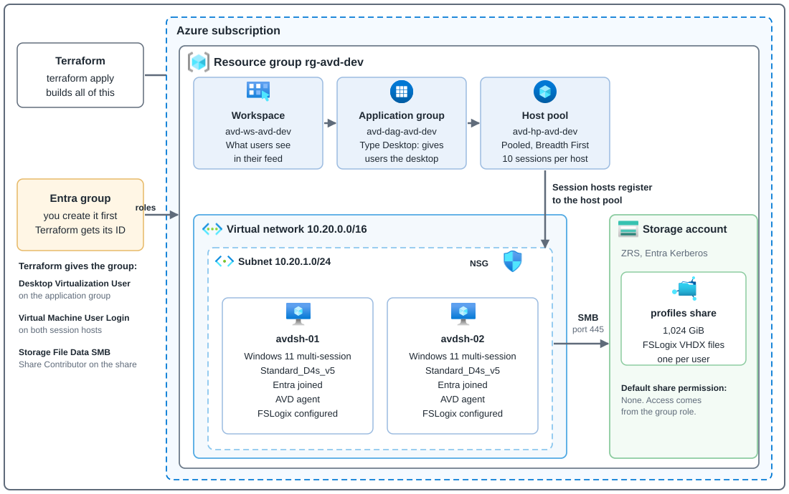

# Azure Virtual Desktop with Terraform

This project deploys a small pooled Azure Virtual Desktop environment for testing, demos, self-learning, and proof-of-concept work.

It creates Microsoft Entra-joined Windows 11 multi-session hosts, an AVD workspace and host pool, Azure Files storage, and FSLogix profile containers.

> This is a working reference project, not a production landing zone. Review security, networking, backup, monitoring, and Terraform state requirements before using it for production workloads.

## Architecture



[Editable Draw.io file](diagrams/avd-architecture.drawio)

A step-by-step walkthrough of this lab is on the blog: [Deploy an AVD Quick Lab with Terraform](https://adnanasiddiqui.com/terraform-labs/avd-quick-lab/).

## What gets deployed

| Component | Default configuration |
|---|---|
| Resource group | `rg-avd-dev` |
| AVD host pool | Pooled, Breadth First |
| Session hosts | 2 Microsoft Entra-joined VMs |
| VM size | `Standard_D4s_v5` — 4 vCPUs and 16 GiB RAM per host |
| Operating system | Windows 11 Enterprise multi-session with Microsoft 365 Apps |
| AVD resources | One workspace and one desktop application group |
| Network | `10.20.0.0/16` VNet and `10.20.1.0/24` session-host subnet |
| Public VM IPs | None |
| Storage | Standard StorageV2 with ZRS |
| FSLogix share | `profiles`, 1,024 GiB quota |
| File authentication | Microsoft Entra Kerberos |
| Profile format | FSLogix VHDX |

Terraform also installs the AVD Agent, enables `AADLoginForWindows`, configures FSLogix on each host, and assigns the required AVD, VM login, and Azure Files roles to the supplied Microsoft Entra group.

## Approximate 12-hour lab cost

The following example uses East US pay-as-you-go rates checked in August 2026.

| Item | Approximate cost |
|---|---:|
| Two `Standard_D4s_v5` VMs running for 12 hours | $4.61 |
| Two 128 GiB Premium SSD OS disks for 12 hours | $0.65 |
| Small FSLogix test profile and Azure Files transactions | Less than $0.10 |
| AVD control plane, VNet, subnet, NSG, and role assignments | No separate charge |
| **Estimated total** | **About $5-$7 USD** |

This estimate assumes eligible AVD licensing, minimal outbound data transfer, and that the lab is destroyed after 12 hours. Prices vary by region, agreement, taxes, storage usage, and exchange rate. Check the [Azure Pricing Calculator](https://azure.microsoft.com/en-us/pricing/calculator/) before deployment.

Deallocating the VMs stops compute charges, but disks and stored profiles continue to incur charges until they are deleted.

## Before you start

You need:

- An Azure subscription and permission to create resources and role assignments.
- Terraform 1.9 or newer, Azure CLI, and Visual Studio Code.
- A Microsoft Entra security group for AVD users.
- A Windows 11 multi-session image available in the selected Azure region.
- Appropriate Microsoft licensing for Azure Virtual Desktop.

## Configure the project

1. Clone or download the repository.
2. Open the folder containing `main.tf` in Visual Studio Code.
3. Open a new VS Code terminal.
4. Create your local variables file:

   ```powershell
   Copy-Item terraform.tfvars.example terraform.tfvars
   ```

5. Open `terraform.tfvars` and update:

   - `subscription_id`
   - `location`
   - `windows_image_version`
   - `admin_username`
   - `admin_password`
   - `avd_user_group_object_id`
   - `storage_account_name`

`terraform.tfvars` is ignored by Git. Do not add it to the repository.

### Find an image version

```powershell
az vm image list `
  --location eastus `
  --publisher MicrosoftWindowsDesktop `
  --offer office-365 `
  --sku win11-24h2-avd-m365 `
  --all `
  --query "sort_by(@, &version)[-1].version" `
  --output tsv
```

Copy the returned version into `windows_image_version`. The image must exist in the region selected in `terraform.tfvars`.

## Deploy

```powershell
az login
az account set --subscription "<SUBSCRIPTION_ID_OR_NAME>"

terraform init
terraform fmt -check -recursive
terraform validate
terraform plan -out=avd.tfplan
terraform apply "avd.tfplan"
```

Terraform displays the host pool, workspace, session hosts, storage account, and FSLogix UNC path after the deployment finishes.

## Required steps after deployment

Terraform creates the resources, but the Azure Files application consent and FSLogix folder permissions still need to be completed in the Azure portal.

Follow [Post-deployment configuration](docs/post-deployment.md). It shows the exact portal location for:

- Checking that the session hosts are **Available**.
- Adding test users to the AVD user group.
- Granting consent to the storage-account application.
- Adding `kdc_enable_cloud_group_sids` for cloud-only users.
- Checking the Azure Files role assignments.
- Setting the `AVD_Users` and `CREATOR OWNER` folder permissions.
- Testing FSLogix profile creation and persistence.

## Quick validation

On each session host, check:

```powershell
dsregcmd /status
Get-Service RDAgentBootLoader, RdAgent, frxsvc
Get-ItemProperty 'HKLM:\SOFTWARE\FSLogix\Profiles'
Get-ItemProperty 'HKLM:\SYSTEM\CurrentControlSet\Control\Lsa\Kerberos\Parameters'
Get-ItemProperty 'HKLM:\SOFTWARE\Policies\Microsoft\AzureADAccount'
```

Expected results:

- `AzureAdJoined : YES`
- Session-host status: **Available**
- FSLogix `Enabled = 1`
- Correct Azure Files path under `VHDLocations`
- `CloudKerberosTicketRetrievalEnabled = 1`
- `LoadCredKeyFromProfile = 1`

## Project folders

```text
modules/     Terraform modules
scripts/     AVD Agent and FSLogix configuration scripts
docs/        Post-deployment and troubleshooting guides
diagrams/    Architecture diagram and editable Draw.io source
```

## Remove the lab

```powershell
terraform destroy
```

Destroying the storage account also deletes the FSLogix profiles stored in this lab.

## Important notes

- Never commit `terraform.tfvars`, state files, saved plans, passwords, storage keys, or registration tokens.
- Use a protected remote Terraform backend for shared or production deployments.
- The session hosts have no public IP addresses, but the lab leaves outbound connectivity and public Azure Files access enabled.
- Production deployments should include proper egress, Private Endpoint and DNS planning, monitoring, backup, image management, and profile recovery.
- Marketplace images, providers, Azure policies, and Microsoft Entra requirements can change. Always review the plan before applying it.

## Microsoft documentation

- [Azure Virtual Desktop with Terraform](https://learn.microsoft.com/en-us/azure/developer/terraform/azurerm/configure-azure-virtual-desktop)
- [Microsoft Entra-joined AVD session hosts](https://learn.microsoft.com/en-us/azure/virtual-desktop/azure-ad-joined-session-hosts)
- [Microsoft Entra Kerberos for Azure Files](https://learn.microsoft.com/en-us/azure/storage/files/storage-files-identity-auth-hybrid-identities-enable)
- [FSLogix profiles with Azure Files and Microsoft Entra ID](https://learn.microsoft.com/en-us/fslogix/how-to-configure-profile-container-entra-id-hybrid)
